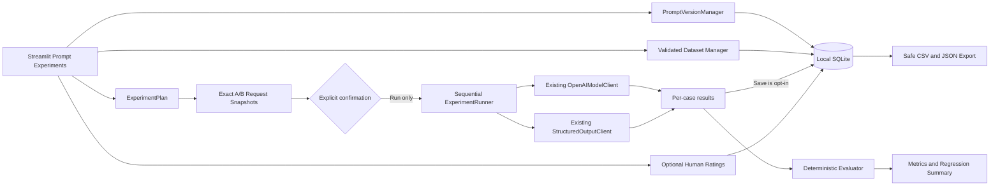
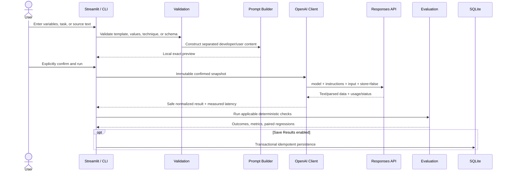

# Architecture

## Responsibilities

The project follows a conventional `src` layout. `ai_prompt_studio` is the only
importable application package.

| Component | Responsibility |
| --- | --- |
| `config.py` | Load `.env` and validate secrets, model, timeout, retries, and base developer guidance. |
| `models.py` | Define immutable Pydantic models and validate template structure. |
| `templates.py` | Own the catalogue of built-in, versioned templates. |
| `builder.py` | Validate values, render user content, and assemble developer instructions. |
| `client.py` | Adapt the official OpenAI SDK, normalize results, and translate failures into safe errors. |
| `studio.py` | Provide UI-independent preview, confirmation, execution timing, and state-reset helpers. |
| `techniques.py` | Model and construct M3 techniques, approved personas, comparison snapshots, and deterministic checks. |
| `structured_outputs.py` | Define approved M4 Pydantic schemas, registry, preview, structured client extension, and business checks. |
| `versioning.py` | Create editable drafts and immutable published prompt snapshots with stable content hashes. |
| `datasets.py` | Validate, import, and load versioned evaluation datasets and per-case check specifications. |
| `experiments.py` | Build auditable A/B plans/effective requests and run explicitly confirmed requests sequentially. |
| `evaluation.py` | Perform deterministic checks, validate human ratings, calculate metrics, and find paired regressions. |
| `persistence.py` | Persist local prompts, versions, datasets, runs, results, evaluations, and ratings in SQLite. |
| `exports.py` | Serialize experiment results safely as JSON and spreadsheet-safe CSV. |
| `cli.py` | Coordinate template choice, input, preview, confirmation, execution, and repeat/exit. |
| `streamlit_app.py` | Render widgets and coordinate Streamlit session state without duplicating business logic. |

## Request flow

```text
                         environment
                              |
                         AppSettings
                              |
          +-------------------+-------------------+
          |                                       |
   Streamlit UI                              M1 CLI (preserved)
      /       \                                    |
 studio.py   techniques.py                        |
      |            |                               |
 PromptBuilder  TechniquePromptBuilder             |
      |            |                               |
      +-------> RenderedPrompt <-------------------+
                   instructions | input
                            |
                    OpenAIModelClient
                            |
                 OpenAI Responses API
                            |
        text + optional usage + measured UI latency
```

`RenderedPrompt` has two separate fields. `developer_instructions` contains
trusted application and template guidance. `user_prompt` contains the rendered
task content, including every untrusted value entered at the CLI. The model
client sends these as the Responses API's `instructions` and `input` arguments,
respectively.

## Template validation

At template-definition time, Pydantic checks IDs, semantic-style versions,
non-empty fields, unique variable names, and exact agreement between declared
variables and placeholders. Placeholders must be plain identifiers. Attribute
access, item access, conversion flags, and format specifications are rejected.

At render time, `PromptBuilder` rejects missing keys, extra keys, non-string
values, and whitespace-only values. It then uses `str.format_map`. Braces and
special characters inside a supplied value are inserted as data and are not
parsed a second time.

## OpenAI boundary

`OpenAIModelClient` receives validated settings and a `RenderedPrompt`. SDK
construction sets the configured request timeout and bounded retry count. Each
request sets the configured model and `store=False`. Authentication, rate-limit,
API, and unexpected errors are converted to fixed user-facing messages so raw
provider details or secrets are not printed. Response text is read from the
SDK's `output_text` helper; usage is normalized only when present.

The client accepts an injected SDK-compatible object. Tests use this seam to
verify exact request arguments without network access.

## Streamlit interaction model

The root `streamlit_app.py` reads `TEMPLATES`; it never defines prompt templates.
Each declared `required_input_variables` entry becomes a field with a stable key
scoped by template ID. The form passes those values to the existing
`PromptBuilder`, which remains the sole render-time validation layer.

The workflow has two stages:

1. **Build and preview** validates variables and renders locally. It makes no API call.
2. **Confirm and run** lets the user edit only the rendered user prompt, requires explicit confirmation, and calls the existing client only from the Run button block.

Developer instructions stay read-only and separate from the editor. A confirmed
prompt is a new immutable `RenderedPrompt` containing the exact visible user
text. A monotonic clock measures the client call on successful execution.

## Session-state rules

Session state stores the selected template, template-scoped widget values,
latest preview, confirmed prompt, latest execution record, and status. It never
stores the API key. Template changes invalidate preview and response state.
Editor changes invalidate confirmation and the old answer. A new preview also
clears the previous execution.

Clear Response removes only response and metrics. Reset Prompt Form removes the
selected template's values plus derived preview/response state. These mutations
happen either before widget construction or in supported callbacks, preventing
Streamlit widget-state mutation errors.

Streamlit reruns the script after interactions. The API call is inside the Run
button's conditional; a button is true only for its click rerun. Stored results
are display-only, so an ordinary rerun cannot repeat a paid request. The app is
stateless at the LLM level and never submits prior UI results as conversation
context.

## Prompt Technique Lab

`TechniquePromptBuilder` is parallel to—not a replacement for—the original
template builder. It produces `ConstructedTechniquePrompt`, an inspectable
Pydantic model containing technique, task, developer instructions, user content,
examples, constraints, display metadata, and model ID. Conversion to the
existing `RenderedPrompt` happens only at the shared execution boundary, so
`OpenAIModelClient` remains unchanged.

```text
task + technique controls
          |
TechniquePromptBuilder
          |
ConstructedTechniquePrompt
  | developer instructions
  | user content + demonstrations/constraints
          |
exact local preview -> explicit confirmation
          |
RenderedPrompt -> existing OpenAIModelClient
          |
response + usage + latency -> deterministic constraint checks
```

Zero-shot adds no demonstrations. Few-shot serializes 1–5 example pairs in
order before a clearly separated new task. Role-based prompting adds only a
registry-approved persona to developer instructions. Constraint-based prompting
keeps user-selected values in user content and checks observable response
properties after execution.

Comparison snapshots contain a zero-shot baseline and the selected modified
prompt. Pydantic validation requires the same underlying task and model. Each
variant is executed only through its own explicit button; there is no automatic
winner, persistent experiment history, or statistical evaluation.

## Constraint-check semantics

Words are Unicode word groups; internal apostrophes and hyphens remain part of
one word. Bullets are non-empty lines beginning with `-`, `*`, `•`, or a
numbered marker such as `1.` or `1)`. Maximum words, exact bullet count,
case-insensitive required substrings, and case-insensitive forbidden substrings
return pass or fail. Tone and example-quality requests return not evaluated.
These checks say nothing about factual accuracy.

## Structured Output Lab

M4 extends `OpenAIModelClient`, reusing its configured API key, model, timeout,
bounded retries, and usage extraction. It calls the SDK parsing helper with a
registry-approved Pydantic class:

```text
approved schema registry + untrusted source text
                    |
          StructuredPromptPreview (local)
       developer instructions | user content
                    |
             explicit confirmation
                    |
 responses.parse(text_format=Model, store=False)
                    |
       completed? -> refused? -> output_parsed present?
                    |
          Pydantic model_validate()
                    |
 JSON + typed instance + usage + latency + business checks
```

The registry prevents arbitrary imports or user-selected Python classes. Each
schema inherits a strict Pydantic base with every field required and
`extra="forbid"`, producing `additionalProperties: false`. The schemas use only
simple objects, strings, string arrays, and literal enums from the supported
JSON Schema subset.

The service rejects incomplete and token-truncated responses before inspecting
parsed data. It detects refusals separately, rejects missing `output_parsed`,
and validates the returned object again locally. It never accepts partial JSON
and never retries merely because generated content was incomplete.

Schema adherence and Pydantic type validation are distinct from business-rule
validation. Support-ticket priority always receives `needs_review`. Factual and
semantic accuracy remain outside what JSON Schema can prove.

## Milestone 5 experiment architecture



Published prompt versions are immutable Pydantic snapshots backed by a SQLite
trigger that rejects updates and deletes. A draft can be edited or copied from
any historical version; publishing creates a separate snapshot with a UTC
timestamp and SHA-256 content hash. Git records changes to source-controlled
project files, while this local store records runtime prompt artifacts and their
relationship to experiment runs.

An `ExperimentPlan` fixes both prompt versions, one dataset version, the model,
generation settings, evaluation criteria, and trial count. The runner renders
both variants from the same case before calling the existing API adapters in a
deterministic A-then-B order. Effective developer instructions, user content,
examples, constraints, and schema ID are stored with every result. Individual
failures are retained, so completed results are not lost and accuracy can use
the full planned denominator.

SQLite is deliberately local and single-user. Queries are parameterized and a
run plus all results is saved in one transaction. The unique run ID and
`INSERT OR IGNORE` make repeated save attempts idempotent. Session state holds
the current in-browser plan and result; SQLite is durable storage. Opening
history, rating a response, deleting a saved run, or exporting data never calls
OpenAI.

## Consolidated request lifecycle



### Frontend and registries

`streamlit_app.py` is a presentation coordinator. The template workflow reads
`templates.TEMPLATES`; the technique lab calls `TechniquePromptBuilder`; the
structured lab resolves only `SCHEMA_REGISTRY`; and Prompt Experiments delegates
to the version, dataset, runner, evaluation, persistence, and export modules.
The CLI uses the same template builder and `OpenAIModelClient`.

Streamlit reruns the module after interactions. API calls occur only inside an
explicit button branch. Session state stores browser-session snapshots but not
API keys. Callbacks invalidate stale previews/results when their inputs change.

### API and parsing boundary

`OpenAIModelClient.generate()` is the text boundary. `StructuredOutputClient`
extends it only for `responses.parse`; this avoids duplicate configuration and
error handling. Both pass developer guidance separately from user content, use
the configured model, bounded timeout/retries, and `store=False`. Raw provider
exception text is never returned to users.

### Evaluation, storage, and export boundary

`ExperimentRunner` is UI-independent and sequential. `evaluate_case_output()`
performs only checks declared for a case. `calculate_variant_metrics()` keeps
missing data as unavailable and exposes both planned-denominator and
completed-only accuracy. `detect_regressions()` compares paired case/trial
outcomes without declaring statistical significance.

`SQLiteRepository` owns all SQL and parameter binding. Published-version
triggers preserve history, related run writes use transactions, and duplicate
run IDs are ignored. `exports.py` consumes already stored/returned application
models and cannot call OpenAI.

## Quality and CI boundary

Ruff checks imports, syntax-grade rules, unused code, and formatting. Pytest
uses mocked SDK clients and temporary databases. Streamlit AppTest verifies
button-gated calls and rerun behavior. `.github/workflows/python-ci.yml` runs
these gates under Python 3.11 with read-only repository permission and no API
secrets. CI validates software behavior; optional live model quality remains a
manual, potentially paid test.

