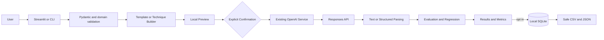

# AI Prompt Engineering & Content Studio

A local Python and Streamlit learning application for building, previewing,
executing, versioning, and evaluating prompts with the OpenAI Responses API.
The project demonstrates five prompt-engineering milestones in one testable
architecture; it is a portfolio project, not a production deployment.

## Problem being solved

Prompts often begin as untracked strings mixed into UI code. That makes role
boundaries unclear, changes hard to reproduce, structured responses fragile,
and comparisons subjective. This studio treats prompts as validated engineering
artifacts: templates have contracts, requests have explicit trust boundaries,
published versions are immutable, and experiments use fixed datasets and named
evaluation rules.

## Key features

- Reusable templates with strict missing/extra/empty-variable validation
- Separate application-controlled developer instructions and untrusted user content
- Local preview, editable user prompt, and explicit confirmation before inference
- Zero-shot, few-shot, approved-persona, and constraint-based prompt labs
- Structured Outputs parsed into three strict Pydantic models
- Draft and immutable published prompt versions with SHA-256 content hashes
- Validated datasets, including 12 synthetic sentiment cases
- Sequential paired A/B experiments with request caps and cost-exposure preview
- Deterministic checks, optional human ratings, and paired regression detection
- Opt-in local SQLite history and formula-safe CSV/JSON export
- CLI and four Streamlit workspaces
- Offline pytest/AppTest suite, Ruff quality gates, and GitHub Actions CI

## Technology stack

Python 3.11+, OpenAI Python SDK, Responses API, Pydantic v2,
python-dotenv, Streamlit, built-in `sqlite3`, pytest, Ruff, and GitHub Actions.
No LangChain, agent framework, RAG system, or additional LLM provider is used.

## Architecture



Business logic lives in `ai_prompt_studio`. The root `streamlit_app.py`
coordinates widgets and session state; it does not implement another API client.
See [ARCHITECTURE.md](ARCHITECTURE.md) for the complete request lifecycle.

## Prompt builder and templates

`PromptTemplate` verifies metadata, simple placeholder names, and agreement
between placeholders and declared variables. `PromptBuilder.build()` rejects
missing, unexpected, non-string, and blank values, substitutes values once, and
returns an immutable `RenderedPrompt`. Braces inside values remain data because
inserted values are not evaluated or formatted a second time.

## Prompting techniques

`TechniquePromptBuilder` supports zero-shot, one-to-five ordered few-shot
demonstrations, four registry-approved communication personas, and validated
constraints. User demonstrations remain user content. An approved persona may
extend developer guidance, but a persona is not an API message role. Observable
constraints have deterministic checks; tone and truth are not falsely presented
as mechanically verified.

## Structured Outputs

The approved schema registry contains sentiment-analysis, customer-support, and
article-summary Pydantic models. `StructuredOutputClient` calls
`responses.parse(..., text_format=Model, store=False)`. It distinguishes refusal,
incomplete/truncated output, missing parsed data, unsupported requests, and
Pydantic failure. Schema adherence does not prove factual or policy correctness.

## Prompt versioning

`PromptVersionManager` creates definitions, editable drafts, immutable published
snapshots, historical restores, preferred versions, comparisons, UTC timestamps,
change descriptions, and content hashes. SQLite triggers protect published rows.
Editing history means copying a snapshot into a new draft, not overwriting it.

## A/B experimentation and datasets

An `ExperimentPlan` fixes baseline A, candidate B, model, generation behavior,
dataset version, cases, checks, and trial count. The UI displays
`cases × 2 variants × trials` before confirmation. The sequential runner stores
exact effective developer instructions, user content, examples, constraints,
schema ID, responses, usage, latency, and individual safe failures.

The packaged dataset has 12 synthetic, manually reviewed positive, negative,
neutral, mixed, and edge cases. JSON imports are limited to 1 MB/100 cases,
validated with Pydantic, and never executed as code.

## Evaluation and regression detection

Checks include exact labels, nonempty output, JSON syntax, Pydantic schema,
required fields, enums, word limits, and required/forbidden phrases. Free-text
sentiment uses an anchored parser rather than a fragile substring guess. Planned
and completed-only accuracy are separate, so request failures stay visible.
Paired results identify both-correct, A-only, B-only, and both-incorrect cases.
Human 1–5 dimensions remain separate. Small-sample conclusions are exploratory.

## Streamlit interface

The sidebar exposes Template Studio, Prompt Technique Lab, Structured Output
Lab, and Prompt Experiments. Preview actions are local. Only explicitly labeled
Run/Generate actions can call OpenAI. Widget changes and ordinary reruns cannot
repeat a stored request. Session state is UI state, not durable storage or model
conversation memory.

## SQLite history and exports

Saving is off by default. Opted-in history is stored at
`.data/prompt_studio.db` or `PROMPT_STUDIO_DB_PATH`. Parameterized queries and
transactions persist runs idempotently. Opening, rating, deleting, and exporting
history never call OpenAI. CSV neutralizes spreadsheet-formula prefixes; JSON
preserves experiment relationships. Local data is not encrypted.

## Installation

```bash
git clone <your-repository-url>
cd python-ai-prompt-studio
python3.11 -m venv .venv
source .venv/bin/activate
python -m pip install -e '.[dev]'
cp .env.example .env
```

Windows PowerShell activation: `.venv\Scripts\Activate.ps1`.

## Environment configuration

Populate the ignored `.env` with your own values:

```dotenv
OPENAI_API_KEY=your-key-here
OPENAI_MODEL=your-supported-model-id
OPENAI_REQUEST_TIMEOUT=30
OPENAI_MAX_RETRIES=2
```

The model is configuration, not a hardcoded constant. Never commit `.env` or
`.streamlit/secrets.toml`.

## Running the application

```bash
source .venv/bin/activate
streamlit run streamlit_app.py
```

Preserved CLI:

```bash
python -m ai_prompt_studio
```

Previewing is free local computation. Confirmed execution may incur API cost.

## Automated quality checks

```bash
python -m ruff check .
python -m ruff format --check .
python -m pytest
```

OpenAI calls are mocked and SQLite tests use temporary paths. CI runs the same
commands on pushes and pull requests for `main`, without credentials or deployment.

## Security considerations

- Secrets are environment-backed and are never stored in SQLite or exports.
- Provider exceptions become fixed safe messages.
- Requests use bounded timeouts/retries and `store=False`.
- Template syntax is restricted; imported JSON is data only.
- `.env*`, Streamlit secrets, databases/journals, caches, and exports are ignored;
  `.env.example` remains shareable.
- Saved prompts, model output, datasets, and exports can still be sensitive.
- Role separation reduces instruction confusion but cannot defeat every injection.
- There is no authentication, authorization, encryption at rest, tenant isolation,
  or retention policy. Do not host this as a public multi-user service.
- `.gitignore` does not remove historical secrets. Scan history and rotate exposed
  credentials before publication.

## Known limitations

- No live OpenAI call was part of automated release verification.
- Local single-user, unencrypted storage only.
- Sequential experiments are capped at 100 attempts.
- No statistical significance, calibrated cost estimate, or LLM judge.
- The seed dataset cannot establish general model quality.
- Structured validation does not establish truth.
- No authentication, cloud deployment, RAG, agents, or multi-provider support.

## Future improvements

Potential work includes independently reviewed datasets and rubrics, encrypted
retained history, authenticated tenant isolation, explicit pricing configuration,
and statistical experiment design. RAG, agents, and extra providers should remain
separate learning milestones rather than hidden additions.

## Documentation

- [User guide](USER_GUIDE.md)
- [Architecture](ARCHITECTURE.md)
- [Manual test checklist](MANUAL_TEST_CHECKLIST.md)
- [Release checklist](RELEASE_CHECKLIST.md)
- [Master study guide](AI_ENGINEERING_MASTER_STUDY_GUIDE.md)
- [Interview preparation](AI_ENGINEERING_INTERVIEW_PREP.md)
- [14-day revision plan](AI_ENGINEERING_REVISION_PLAN.md)

Primary references: [OpenAI Structured Outputs](https://developers.openai.com/api/docs/guides/structured-outputs),
[streaming Responses](https://developers.openai.com/api/docs/guides/streaming-responses),
and [evaluation best practices](https://developers.openai.com/api/docs/guides/evaluation-best-practices).
